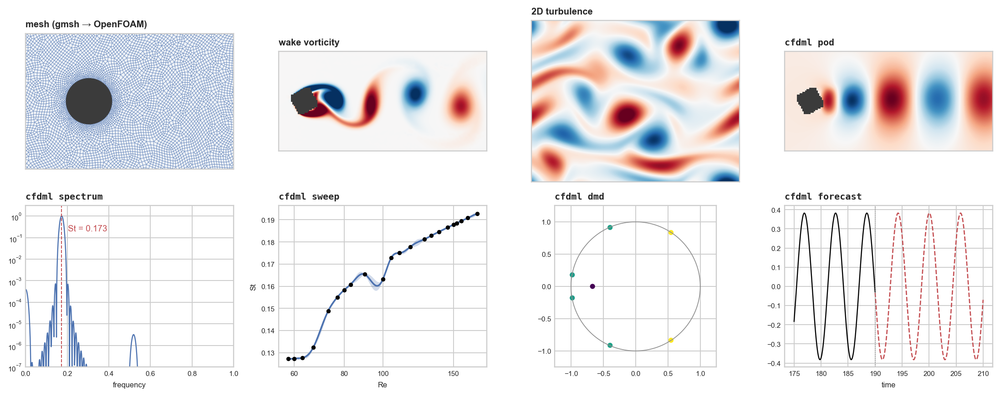
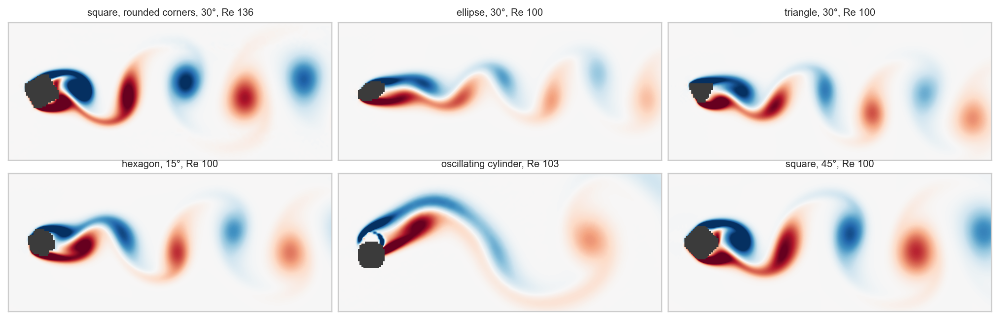
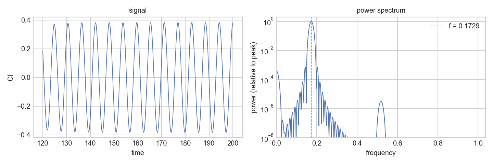
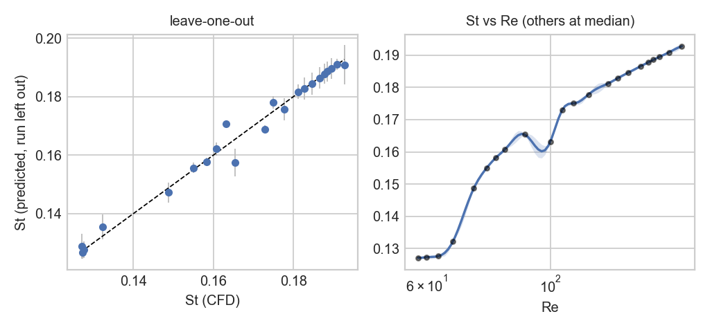
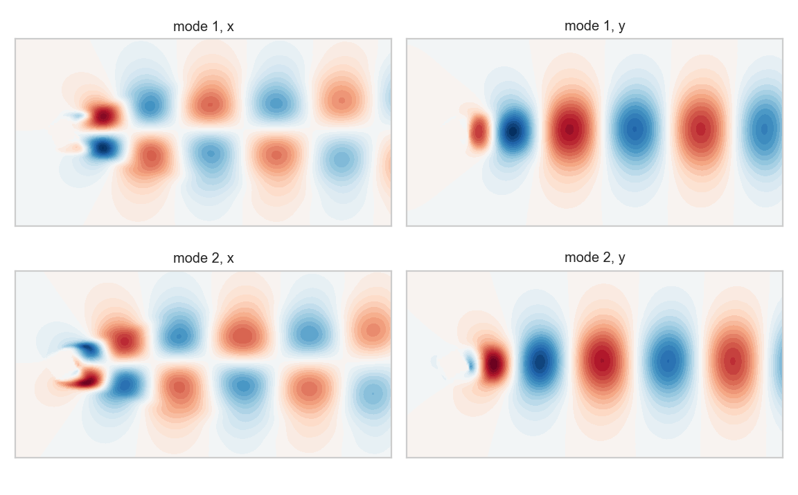
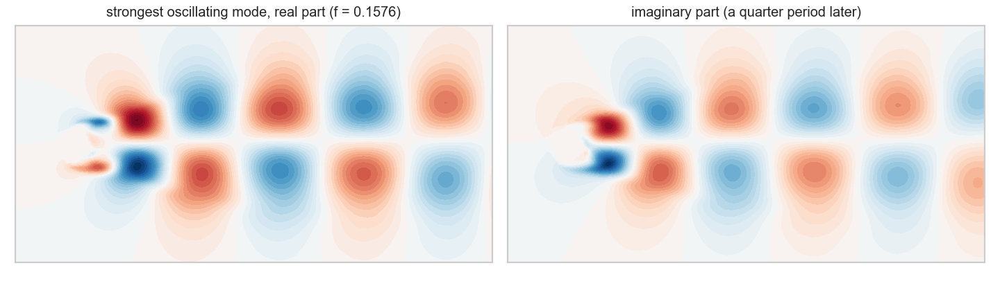
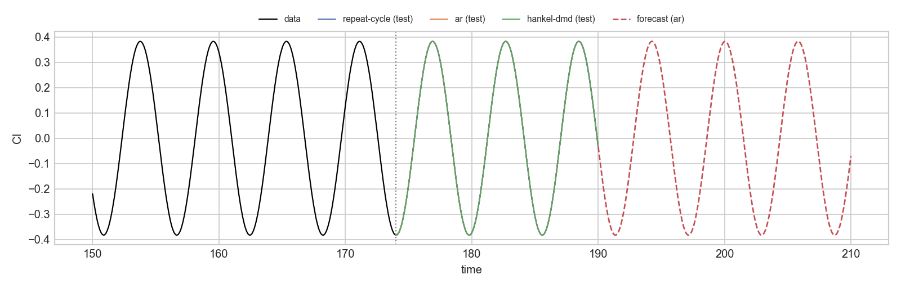

# cfdml

[](https://github.com/IDZTPHKKKS/cfdml/actions/workflows/tests.yml)

Command-line tools for analysing CFD results and fitting simple surrogate models to them. Works on ASCII
OpenFOAM cases, `postProcessing` files, CSVs and VTK files.



| command | does |
|---|---|
| `cfdml info` | lists fields, times and columns in a case or file |
| `cfdml spectrum` | dominant frequency, Strouhal number, spectrum |
| `cfdml pod` | POD modes and energies of a field |
| `cfdml dmd` | DMD frequencies, growth rates and modes |
| `cfdml fieldstats` | field to time series: phase volume, centroid, droplet count, or mean / max / integral |
| `cfdml forecast` | fits a signal's history and predicts ahead, scored against repeating the last cycle |
| `cfdml sweep` | Gaussian-process surrogates over a set of runs, leave-one-out error, suggested next runs |
| `cfdml predict` | outputs and fields at new conditions from a sweep model |

## Install

Python 3.8+.

```bash
pip install git+https://github.com/IDZTPHKKKS/cfdml.git
pip install meshio        # only for VTK files
```

## Quick start

```bash
cfdml demo demo
cfdml info demo/wake
cfdml spectrum demo/wake/postProcessing/forceCoeffs/0/coefficient.dat -c Cl --after 20 -L 1 -U 1
cfdml pod demo/wake -f U --after 20
cfdml fieldstats demo/drops -f alpha.water
cfdml sweep demo/sweep.yaml
cfdml predict demo/cfdml_sweep/model.pkl --at Re=350,angle=4
```

Each command prints a short summary and writes plots and a `report.md` to an output folder (`-o` to choose it).

## Notes on input

- OpenFOAM cases must be ASCII and reconstructed (`foamFormatConvert`, `reconstructPar`).
- `postProcess -func writeCellCentres` and `-func writeCellVolumes` are optional; cell centres are otherwise read
  from the mesh, and volumes default to equal weights.
- Use `--after` to drop the start-up transient.
- Restarted runs with repeated times keep the later values; uneven time steps are resampled.

## Examples

```bash
cfdml spectrum case/postProcessing/forceCoeffs/0/coefficient.dat -c Cl --after 0.5 -L 0.1 -U 2
cfdml pod case -f U --after 0.5 --every 2 --write-modes
cfdml dmd case -f p --after 0.5
cfdml fieldstats case -f alpha.water --after 0.1
cfdml fieldstats case -f T --box 0,0.02,0,0.002,-1,1
cfdml forecast case/postProcessing/forceCoeffs/0/coefficient.dat -c Cl --after 0.5 --train 0.7
```

## Sweeps

```bash
cfdml init sweep
cfdml sweep sweep.yaml
cfdml predict cfdml_sweep/model.pkl --at Re=650,voltage=7.5
cfdml predict cfdml_sweep/model.pkl --grid Re=200:1000:9 --grid voltage=0:10:6
```

`sweep.yaml` lists the inputs, the outputs (read from each run's files, or typed in) and the runs; see the
template from `cfdml init sweep`. A `fields:` entry also fits whole fields (POD + Gaussian process per coefficient),
written back in OpenFOAM format. Scalar outputs use a Gaussian process with a Matern 5/2 kernel and one length scale
per input. Reported errors are leave-one-out.

## Examples from our runs

Images regenerated by `docs/make_images.py`.



Lift spectrum, circular cylinder at Re 105:



Strouhal number over 32 cylinder runs (Re 58 to 172), leave-one-out R2 = 0.98:



POD and DMD of a rounded square cylinder at 30 degrees, Re 136:





Lift forecast:



## Datasets

| | |
|---|---|
| [PDEBench](https://github.com/pdebench/PDEBench) | 1D to 3D PDE benchmarks incl. Navier-Stokes |
| [The Well](https://github.com/PolymathicAI/the_well) | 15 TB of physics simulations: turbulence, convection, shear flows |
| [FlowBench](https://huggingface.co/datasets/BGLab/FlowBench) | flow past complex 2D/3D shapes, Re 10 to 1000 |
| [CFDBench](https://github.com/luo-yining/CFDBench) | cavity, pipe, dam break, cylinder |
| [AirfRANS](https://github.com/Extrality/AirfRANS) | RANS on airfoils (OpenFOAM) |
| [BubbleML](https://github.com/HPCForge/BubbleML) | boiling and bubble dynamics |
| [JHTDB](https://turbulence.pha.jhu.edu/) | DNS turbulence databases |
| [BLASTNet](https://blastnet.github.io/) | reacting and non-reacting DNS |
| [PDEgym / Poseidon](https://huggingface.co/camlab-ethz) | PDE foundation model data and weights |
| [APEBench](https://github.com/Ceyron/apebench) | autoregressive emulator benchmark |

## Related tools

[PyDMD](https://github.com/PyDMD/PyDMD),
[modred](https://github.com/belson17/modred),
[flowtorch](https://github.com/FlowModelingControl/flowtorch),
[fluidfoam](https://github.com/fluiddyn/fluidfoam),
[PySINDy](https://github.com/dynamicslab/pysindy),
[neuraloperator](https://github.com/neuraloperator/neuraloperator),
[DeepXDE](https://github.com/lululxvi/deepxde),
[PhiFlow](https://github.com/tum-pbs/PhiFlow),
[MeshGraphNets](https://github.com/google-deepmind/deepmind-research/tree/master/meshgraphnets),
[Poseidon](https://github.com/camlab-ethz/poseidon)

## Reading

- Brunton & Kutz, [Data-Driven Science and Engineering](http://databookuw.com/)
- Taira et al., [Modal analysis of fluid flows: an overview](https://arxiv.org/abs/1702.01453)
- Brunton, Noack & Koumoutsakos, [Machine learning for fluid mechanics](https://arxiv.org/abs/1905.11075)
- OpenFOAM [function objects](https://doc.openfoam.com/2312/tools/post-processing/function-objects/) and
  [command-line post-processing](https://doc.cfd.direct/openfoam/user-guide-v12/post-processing-cli)

## Tests

```bash
pip install pytest
python -m pytest -q tests
```

MIT licence.
